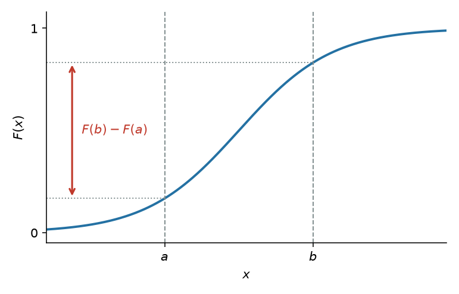
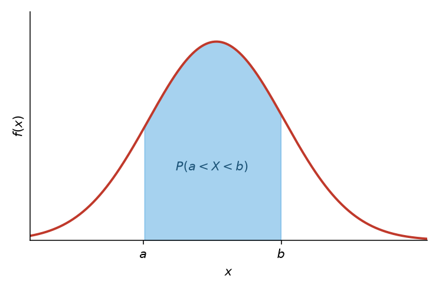
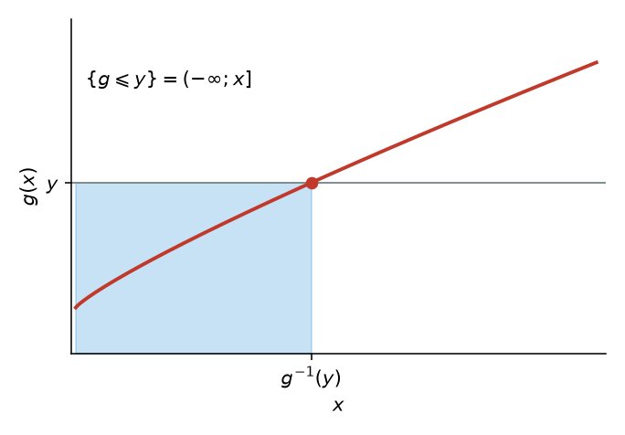
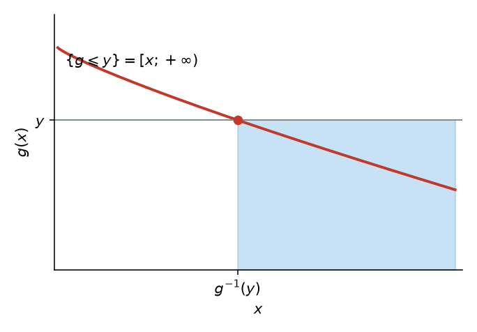
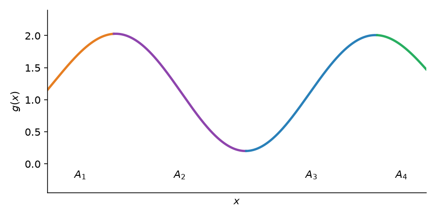
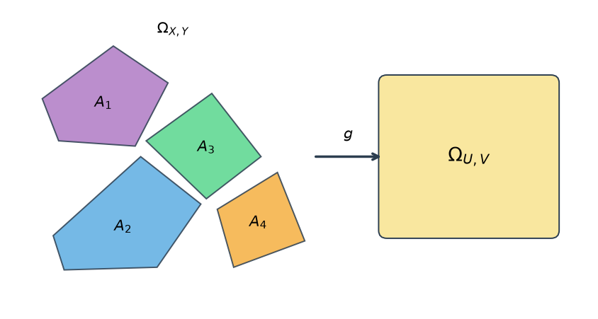

# Практика 7. Непрерывные СВ и преобразования

## Функции распределения и плотности

Функцией распределения называют функцию $F(x)$, определяющую для каждого значения $x$ вероятность того, что случайная величина $X$ примет значение, меньшее $x$,

$$
F(x) = P(X < x).
$$

Свойство 1. Значения функции распределения принадлежат отрезку $[0; 1]$:

$$
0 \leqslant F(x) \leqslant 1.
$$

Свойство 2. Функция распределения есть неубывающая функция:

$$
F(x_2) \geqslant F(x_1), \quad \text{если } x_2 > x_1.
$$

Следствие 1. Вероятность того, что случайная величина $X$ примет значение, заключенное в интервале $(a, b)$, равна приращению функции распределения на этом интервале:

$$
P(a < X < b) = F(b) - F(a).
$$

Следствие 2. Вероятность того, что непрерывная случайная величина $X$ примет одно определенное значение, например $x_1$, равна нулю:

$$
P(X = x_1) = 0.
$$

Свойство 3. Если все возможные значения случайной величины $X$ принадлежат интервалу $(a, b)$, то

$$
F(x) = 0 \text{ при } x \leqslant a; \qquad F(x) = 1 \text{ при } x \geqslant b.
$$

Следствие. Справедливы следующие предельные соотношения:

$$
\lim_{x \to -\infty} F(x) = 0, \qquad \lim_{x \to +\infty} F(x) = 1.
$$

Свойство 4. Функция распределения непрерывна слева:

$$
\lim_{x \uparrow x_0} F(x) = F(x_0).
$$

В современных курсах чаще пишут $F(x)=P(X\leqslant x)$ и непрерывность справа. Здесь — формулировка с $P(X<x)$, как в задачниках.

### Плотность

Плотностью распределения вероятностей непрерывной случайной величины называют первую производную от функции распределения: $f(x) = F'(x)$.

Вероятность того, что непрерывная случайная величина $X$ примет значение, принадлежащее интервалу $(a, b)$, определяется равенством

$$
P(a < X < b) = \int_a^b f(x)\, dx.
$$

Зная плотность распределения, можно найти функцию распределения

$$
F(x) = \int_{-\infty}^{x} f(x)\, dx.
$$

Свойство 1. Плотность распределения неотрицательна, т. е. $f(x) \geqslant 0$.

Свойство 2. Несобственный интеграл от плотности распределения в пределах от $-\infty$ до $\infty$ равен единице: $\int_{-\infty}^{\infty} f(x)\, dx = 1$.

В частности, если все возможные значения случайной величины принадлежат интервалу $(a, b)$, то $\int_a^b f(x)\, dx = 1$.

## Преобразование одномерной СВ

Пусть $X \sim f_X(x)$ — непрерывная случайная величина с носителем $\mathcal{X}$. Пусть случайная величина $Y$ задана через преобразование $Y = g(X)$. Тогда $Y$ имеет функцию распределения

$$
F_Y(y) = \int_{\{x \in \mathcal{X} : g(x) \leqslant y\}} f_X(x)\, dx.
$$

Дальше есть два пути: посчитать напрямую по этой формуле или разбить на монотонно возрастающие/убывающие интервалы, чтобы взять обратную функцию.

## Строго монотонные преобразования

Пусть $X \sim F_X(x)$ и $Y = g(X)$, где $g(x)$ является строго монотонным преобразованием. Тогда

1. $g$ возрастает на $\mathcal{X}$ $\implies$ $F_Y(y) = F_X\bigl(g^{-1}(y)\bigr)$, $y \in \mathcal{Y}$;
2. $g$ убывает на $\mathcal{X}$ и $X$ является непрерывной $\implies$ $F_Y(y) = 1 - F_X\bigl(g^{-1}(y)\bigr)$, $y \in \mathcal{Y}$.

Диффеоморфизмом называется такая биективная функция $g(x)$, обратная $g^{-1}(y)$ которой является непрерывно дифференцируемой.

Пусть $X \sim f_X(x)$ является непрерывной случайной величиной и $Y = g(X)$, где $g$ является диффеоморфизмом и строго монотонной функцией. Тогда плотность вероятности $Y$ имеет вид

$$
f_Y(y) =
\begin{cases}
f_X\bigl(g^{-1}(y)\bigr) \left|\dfrac{d}{dy} g^{-1}(y)\right|, & y \in \mathcal{Y}, \\
0, & y \notin \mathcal{Y},
\end{cases}
$$

где $\mathcal{Y}$ — носитель распределения $Y$.

Модуль производной — якобиан в одномерии: сжимаете ось $x$ в $y$, плотность пересчитывается.

## Немонотонные преобразования

Пусть $X \sim f_X(x)$ и $Y = g(X)$. Пусть существует такое разбиение $A_0, A_1, \dots, A_k$ для носителя $\mathcal{X}$ случайной величины $X$, что $f_X(x)$ непрерывна на всех $A_i$ и $P(X \in A_0) = 0$. Пусть существуют функции $g_1(x), \dots, g_k(x)$, определенные на $A_1, \dots, A_k$ соответственно и удовлетворяющие условиям:

1. $g(x) = g_i(x)$, $x \in A_i$;
2. множество $\mathcal{Y} = \{ y : y = g_i(x) \text{ для } x \in A_i \}$ одинаково для каждого $i = 1, \dots, k$;
3. $g_i(x)$, как отображение из $A_i$ в $\mathcal{Y}$, является диффеоморфизмом.

Тогда плотность вероятности $Y$ имеет вид:

$$
f_Y(y) = \sum_{i=1}^{k} f_X\bigl(g_i^{-1}(y)\bigr) \left|\frac{d}{dy} g_i^{-1}(y)\right|, \qquad y \in \mathcal{Y}.
$$

На графике куски $g_{i-1}$, $g_i$, $g_{i+1}$ живут на $A_{i-1}$, $A_i$, $A_{i+1}$.

## Многомерные преобразования

Одномерная случайная величина: $X \sim f_X$, диффеоморфизм $Y = g(X)$, плотность

$$
f_Y(y) = f_X\bigl(g^{-1}(y)\bigr) \left|\frac{d}{dy} g^{-1}(y)\right| \mathbf{1}_{\Omega_Y}(y).
$$

Двумерная случайная величина: $(X, Y) \sim f_{X,Y}$, диффеоморфизм $U = g_1(X, Y)$, $V = g_2(X, Y)$. Обратные отображения: $X = h_1(U, V)$ и $Y = h_2(U, V)$. Плотность

$$
f_{U,V}(u, v) = f_{X,Y}\bigl(h_1(u, v), h_2(u, v)\bigr) |J| \mathbf{1}_{\Omega_{U,V}}(u, v).
$$

В многомерном случае производная обратной функции заменяется на якобиан:

$$
J = \begin{vmatrix}
\dfrac{\partial h_1(u, v)}{\partial u} & \dfrac{\partial h_1(u, v)}{\partial v} \\[6pt]
\dfrac{\partial h_2(u, v)}{\partial u} & \dfrac{\partial h_2(u, v)}{\partial v}
\end{vmatrix}
= \frac{\partial h_1}{\partial u}\frac{\partial h_2}{\partial v} - \frac{\partial h_2}{\partial u}\frac{\partial h_1}{\partial v},
$$

где $J \ne 0$ и $(u, v) \in \Omega_{U,V}$.

Небиективное преобразование: разбиение $A_0, A_1, \dots, A_k \subset \Omega_{X,Y}$,

- $P\bigl((X, Y) \in A_0\bigr) = 0$;
- для $A_i$ дан диффеоморфизм $(U, V) = \bigl(g_{1i}(X, Y), g_{2i}(X, Y)\bigr)$, отображающий $A_i$ в $\Omega_{U,V}$;
- обратное преобразование: $(X, Y) = \bigl(h_{1i}(U, V), h_{2i}(U, V)\bigr)$.

$$
f_{U,V}(u, v) = \sum_{i=1}^{k} f_{X,Y}\bigl(h_{1i}(u, v), h_{2i}(u, v)\bigr) |J_i|,
$$

где

$$
J_i = \begin{vmatrix}
\dfrac{\partial h_{1i}}{\partial u} & \dfrac{\partial h_{1i}}{\partial v} \\[6pt]
\dfrac{\partial h_{2i}}{\partial u} & \dfrac{\partial h_{2i}}{\partial v}
\end{vmatrix}.
$$

Сумма — преобразование $(x, y) \to (x + y, y)$: $u = x + y$, $v = y$, якобиан равен 1, обратное $x = u - v$, $y = v$,

$$
f_{U,V}(u, v) = f_{X,Y}(u - v,\ v).
$$

Если $X$ и $Y$ независимы, совместная плотность равна произведению. Маргинал по $v$ даёт плотность суммы:

$$
f_U(u) = \int_{-\infty}^{+\infty} f_X(u - v)\, f_Y(v)\, dv.
$$
