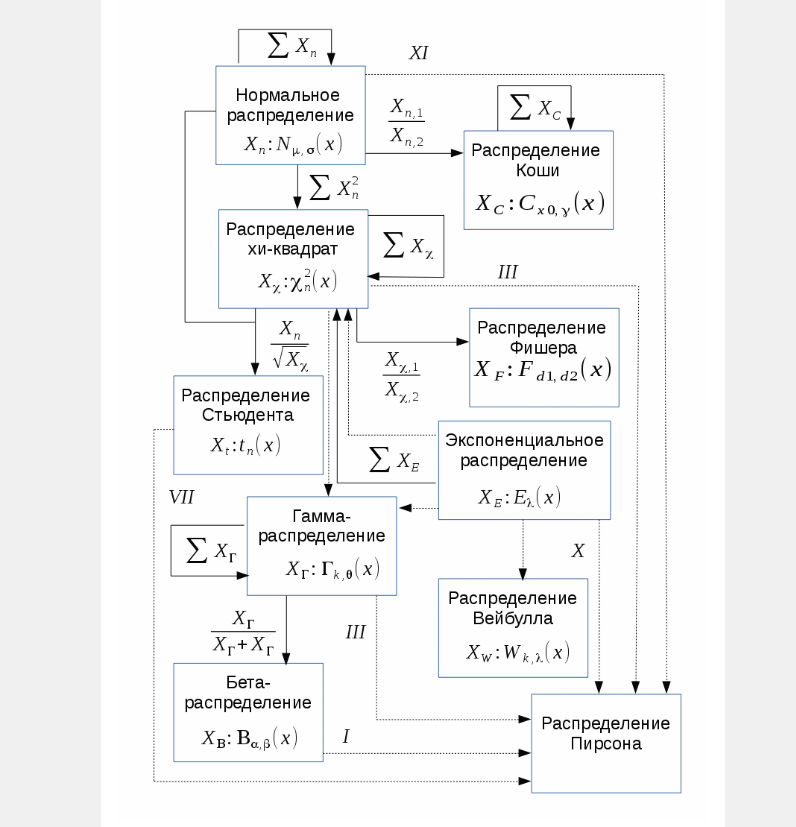
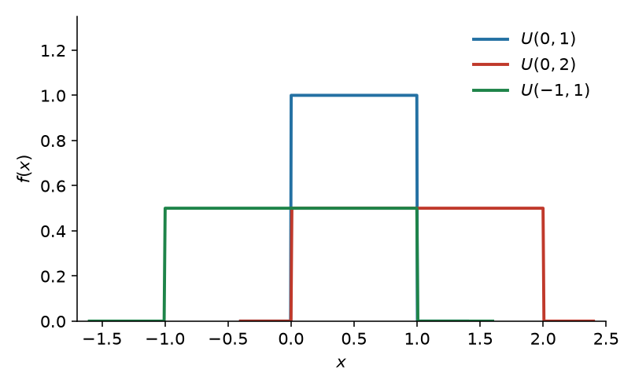
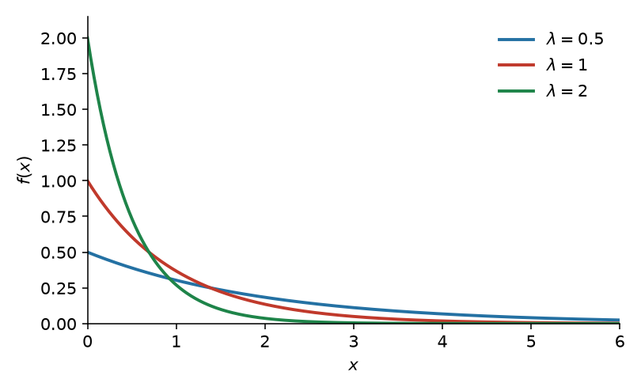
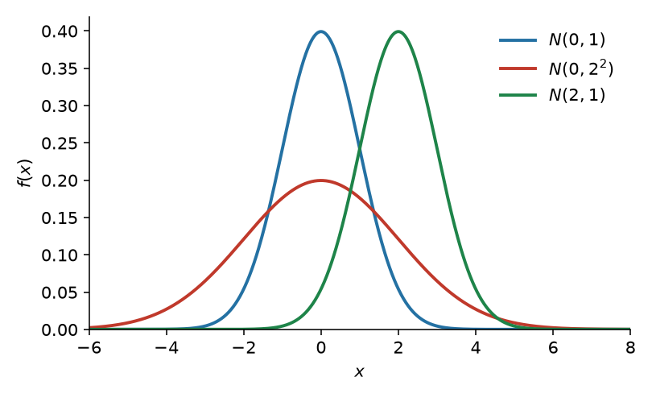
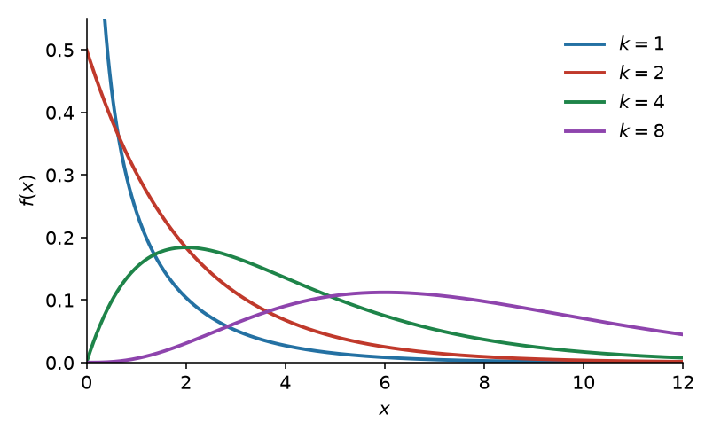
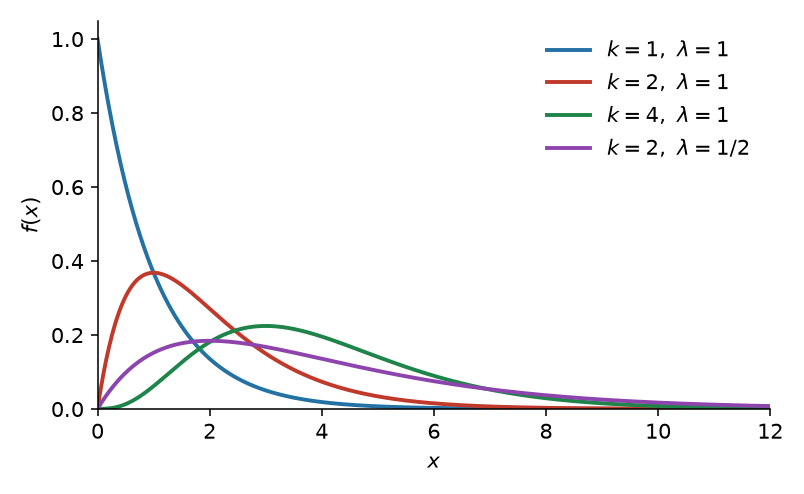
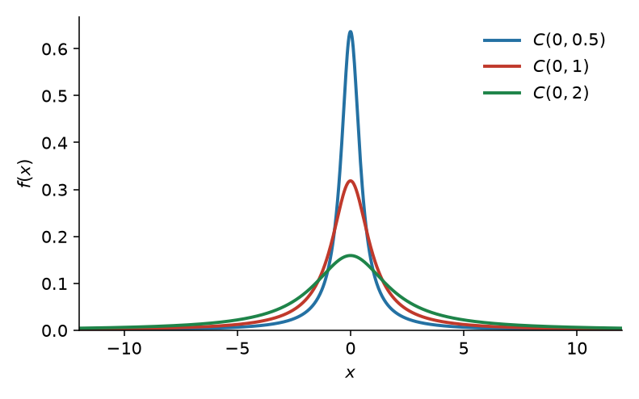
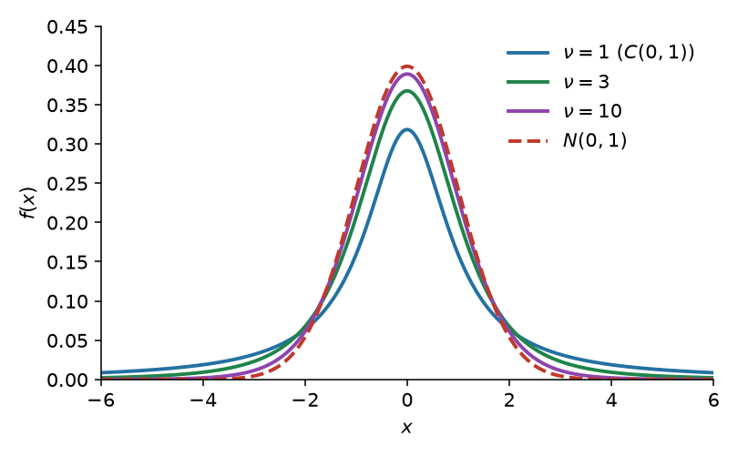
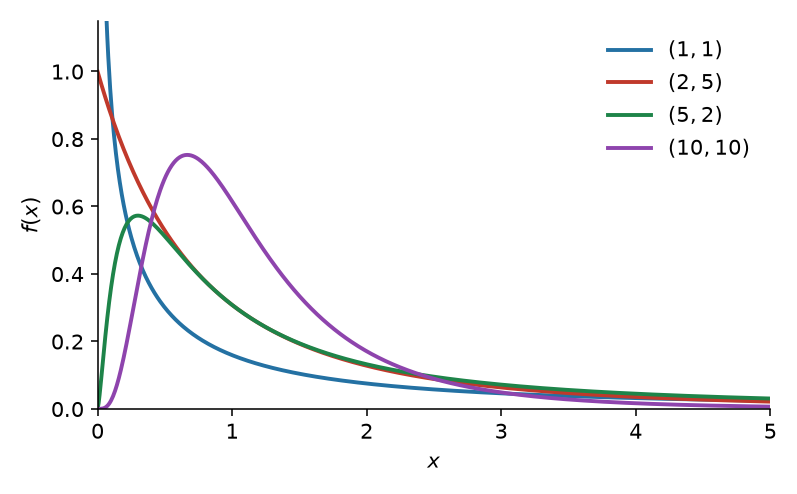
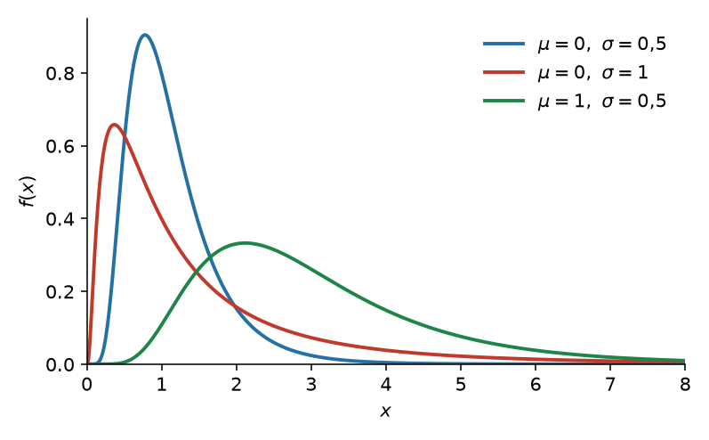

# Практика 8. Зоопарк непрерывных распределений

В отличие от дискретных распределений, где каждое создано под конкретную цель, основная польза известных непрерывных — в том, что они удобно связаны друг с другом.

Берём три распределения с понятным физическим смыслом (равномерное, экспоненциальное, нормальное) и выводим из них остальные.

## Равномерное

| | $U(a,b)$ |
|---|---|
| Носитель | $x\in[a,b]$ |
| Функция распределения | $0$ при $x<a$; $\dfrac{x-a}{b-a}$ при $a\le x\le b$; $1$ при $x>b$ |
| Плотность | $\dfrac{1}{b-a}$ на $(a,b)$ |
| Матожидание | $\dfrac{a+b}{2}$ |
| Дисперсия | $\dfrac{(b-a)^2}{12}$ |

Чаще всего возникает в геометрических задачах и в задачах, где мы ничего не знаем об объекте.

## Экспоненциальное

| | $\operatorname{Exp}(\lambda)$ |
|---|---|
| Носитель | $x\in[0;+\infty)$ |
| Функция распределения | $1-e^{-\lambda x}$ при $x\ge 0$ |
| Плотность | $\lambda e^{-\lambda x}$ при $x\ge 0$ |
| Матожидание | $\dfrac{1}{\lambda}$ |
| Дисперсия | $\dfrac{1}{\lambda^2}$ |

Показательный закон надёжности: длительность времени безотказной работы элемента. Интервалы простейшего потока событий — тоже экспоненциальные: время до первого события.

Экспоненциальное можно использовать **только** при отсутствии старения: вероятность поломки за промежуток $X$ не зависит от того, где этот $X$ расположен и наоборот: при отсутствии старения можно использовать **только** экспоненциальное. Должно выполняться $P(X)P(Y) = P(X+Y)$, а решения этого уравнения всегда вида $e^{ax}$.

Для жизни одной детали этого достаточно. Если отказ — первое событие потока, к отсутствию старения добавляется постоянная интенсивность (стационарность); ординарность нужна, чтобы в $dt$ писать $\lambda\,dt$.

## Нормальное

| | $N(\mu,\sigma^2)$ |
|---|---|
| Носитель | $x\in(-\infty;+\infty)$ |
| Функция распределения | $\Phi\bigl((x-\mu)/\sigma\bigr)$, где $\Phi(x)=\dfrac{1}{\sqrt{2\pi}}\displaystyle\int_{-\infty}^{x} e^{-t^{2}/2}\,dt$ |
| Плотность | $\dfrac{1}{\sigma\sqrt{2\pi}}\,e^{-\frac12\bigl((x-\mu)/\sigma\bigr)^2}$ |
| Матожидание | $\mu$ |
| Дисперсия | $\sigma^2$ |

Существует ЦПТ: центральные предельные теоремы (ЦПТ) — класс теорем в теории вероятностей, утверждающих, что сумма достаточно большого количества слабо зависимых случайных величин, имеющих примерно одинаковые масштабы (ни одно из слагаемых не доминирует, не вносит в сумму определяющего вклада), имеет распределение, близкое к нормальному.

Из-за этого распределение многих вещей в природе близко к нормальному:

- погрешности измерений
- рост людей
- точка, куда попадёт стрела по оси $X$

## Хи-квадрат

| | $\chi^2(k)$ |
|---|---|
| Носитель | $x\in[0;+\infty)$ |
| Функция распределения | $\dfrac{\gamma(k/2,\,x/2)}{\Gamma(k/2)}$ |
| Плотность | $\dfrac{(1/2)^{k/2}}{\Gamma(k/2)}\,x^{k/2-1}e^{-x/2}$ |
| Матожидание | $k$ |
| Дисперсия | $2k$ |

Его уже получили в практике 7, возведением стандартного нормального в квадрат: если $Z_1,\ldots,Z_k$ независимы и $N(0,1)$, то $Z_1^2+\cdots+Z_k^2\sim\chi^2(k)$. Живёт в матстате: выборочная дисперсия нормальной выборки, критерий согласия Пирсона.

## Гамма

Форма $k>0$, интенсивность $\lambda>0$ (как у экспоненциального). Другая параметризация — масштаб $\theta=1/\lambda$.

| | $\Gamma(k,\lambda)$ |
|---|---|
| Носитель | $x\in(0;+\infty)$ |
| Функция распределения | $\dfrac{\gamma(k,\,\lambda x)}{\Gamma(k)}$ |
| Плотность | $\dfrac{\lambda^k}{\Gamma(k)}\,x^{k-1}e^{-\lambda x}$ |
| Матожидание | $\dfrac{k}{\lambda}$ |
| Дисперсия | $\dfrac{k}{\lambda^2}$ |

Время до $n$-го события простейшего потока; суммы времён обслуживания, осадки, страховые выплаты. Для этого нужны все три аксиомы простейшего потока: интервалы н.о.р. экспоненциальные с постоянным $\lambda$, события поодиночке.

Связь с уже известными:

- $\operatorname{Exp}(\lambda)=\Gamma(1,\lambda)$
- Эрланг: $\Gamma(n,\lambda)$ при целом $n$ — сумма $n$ независимых $\operatorname{Exp}(\lambda)$
- $\chi^2(k)=\Gamma(k/2,\,\lambda=1/2)$

## Коши

| | $C(x_0,y)$ |
|---|---|
| Носитель | $x\in(-\infty;+\infty)$ |
| Функция распределения | $\dfrac{1}{\pi}\operatorname{arctg}\dfrac{x-x_0}{y}+\dfrac12$ |
| Плотность | $\dfrac{1}{\pi y\bigl(1+\bigl((x-x_0)/y\bigr)^2\bigr)}$ |
| Матожидание | не существует |
| Дисперсия | не существует |

Отношение двух независимых стандартных нормальных; ордината случайного луча. Хвосты настолько тяжёлые, что нет матожидания: выборочное среднее не сходится к константе (снова Коши), ЦПТ не работает. Стандартное $C(0,1)$ — это Стьюдент с $\nu=1$.

## Стьюдент

| | $t_\nu$ |
|---|---|
| Носитель | $x\in(-\infty;+\infty)$ |
| Функция распределения | $\dfrac12+\dfrac{x\,\Gamma\bigl((\nu+1)/2\bigr)}{\sqrt{\nu\pi}\,\Gamma(\nu/2)}\,{}_2F_1\bigl(\tfrac12,\tfrac{\nu+1}{2};\tfrac32;-x^2/\nu\bigr)$ |
| Плотность | $\dfrac{\Gamma\bigl((\nu+1)/2\bigr)}{\sqrt{\nu\pi}\,\Gamma(\nu/2)}\bigl(1+x^2/\nu\bigr)^{-(\nu+1)/2}$ |
| Матожидание | $0$ при $\nu>1$; иначе не существует |
| Дисперсия | $\dfrac{\nu}{\nu-2}$ при $\nu>2$; иначе не существует |

Если $Z\sim N(0,1)$ и $V\sim\chi^2(\nu)$ независимы, то

$$
t=\frac{Z}{\sqrt{V/\nu}}\sim t_\nu.
$$

Нормальное, делённое на корень из хи-квадрат. При $\nu=1$ это Коши; при $\nu\to\infty$ плотность идёт в $N(0,1)$.

В матстате: нормальная выборка, $\sigma$ неизвестна — статистика $(\bar X-\mu)/(s/\sqrt n)$ имеет распределение Стьюдента. Отсюда $t$-критерии и доверительные интервалы для среднего.

## Фишер

| | $F(d_1,d_2)$ |
|---|---|
| Носитель | $x\in(0;+\infty)$ |
| Функция распределения | $I_{\frac{d_1 x}{d_1 x+d_2}}\bigl(\tfrac{d_1}{2},\tfrac{d_2}{2}\bigr)$ |
| Плотность | $\dfrac{1}{B(d_1/2,\,d_2/2)}\Bigl(\dfrac{d_1}{d_2}\Bigr)^{d_1/2} x^{d_1/2-1}\bigl(1+\tfrac{d_1}{d_2}x\bigr)^{-(d_1+d_2)/2}$ |
| Матожидание | $\dfrac{d_2}{d_2-2}$ при $d_2>2$ |
| Дисперсия | $\dfrac{2d_2^2(d_1+d_2-2)}{d_1(d_2-2)^2(d_2-4)}$ при $d_2>4$ |

Если независимые $U\sim\chi^2(d_1)$, $V\sim\chi^2(d_2)$, то

$$
F=\frac{U/d_1}{V/d_2}\sim F(d_1,d_2).
$$

Отношение двух хи-квадрат. В матстате — сравнение двух выборочных дисперсий, дисперсионный анализ.

## Логнормальное

| | $\operatorname{LogN}(\mu,\sigma^2)$ |
|---|---|
| Носитель | $x\in(0;+\infty)$ |
| Функция распределения | $\Phi\bigl((\ln x-\mu)/\sigma\bigr)$ |
| Плотность | $\dfrac{1}{x\sigma\sqrt{2\pi}}\exp\bigl[-(\ln x-\mu)^2/(2\sigma^2)\bigr]$ |
| Матожидание | $e^{\mu+\sigma^2/2}$ |
| Дисперсия | $\bigl(e^{\sigma^2}-1\bigr)e^{2\mu+\sigma^2}$ |

Логнормальное распределение появляется как распределение преобразования $X=e^Y$, где $Y\sim n(\mu,\sigma^2)$.

- Нормальное распределение моделирует аддитивное наполнение ошибки
- Логнормальное распределение моделирует мультипликативное наполнение ошибки

Например, рассмотрим модель экспоненциального роста популяции $N$

$$
\frac{dN}{dt}=(r+\omega(t))N,
$$

где $r$ — скорость роста и $\omega(t)$ — некоторый случайный шум.
