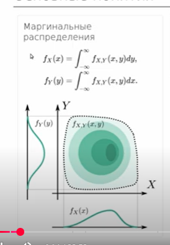
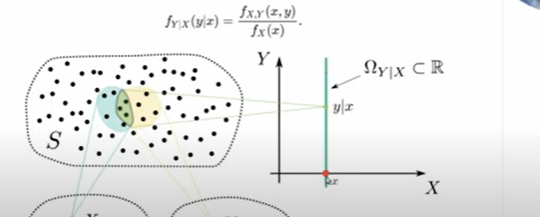
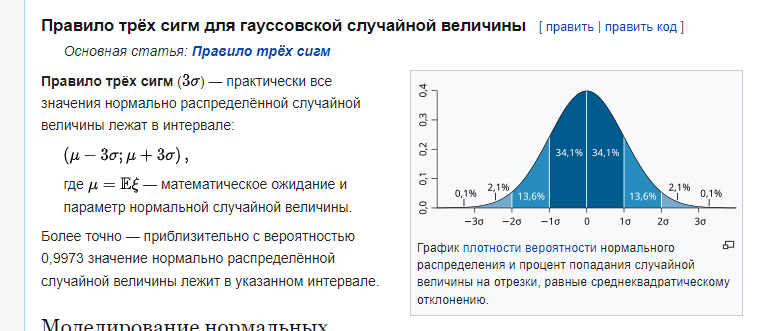

# Практика 9. Многомерные, ЗБЧ и ЦПТ

## Многомерная функция распределения

Двумерной называют случайную величину $(X, Y)$, возможные значения которой есть пары чисел $(x, y)$. Составляющие $X$ и $Y$, рассматриваемые одновременно, образуют систему двух случайных величин.

Двумерную величину геометрически можно истолковать как случайную точку $M(X; Y)$ на плоскости $xOy$ либо как случайный вектор $\overrightarrow{OM}$.

Функцией распределения вероятностей двумерной случайной величины называют функцию $F(x, y)$, определяющую для каждой пары чисел $(x, y)$ вероятность того, что $X$ примет значение, меньшее $x$, и при этом $Y$ примет значение, меньшее $y$:

$$
F(x, y) = P(X < x,\ Y < y).
$$

Геометрически это равенство можно истолковать так: $F(x, y)$ есть вероятность того, что случайная точка $(X, Y)$ попадет в бесконечный квадрант с вершиной $(x, y)$, расположенный левее и ниже этой вершины.

Функция распределения обладает следующими свойствами.

Свойство 1. Значения функции распределения удовлетворяют двойному неравенству

$$
0 \leqslant F(x, y) \leqslant 1.
$$

Свойство 2. Функция распределения есть неубывающая функция по каждому аргументу:

$$
F(x_2, y) \geqslant F(x_1, y), \quad \text{если } x_2 > x_1,
$$

$$
F(x, y_2) \geqslant F(x, y_1), \quad \text{если } y_2 > y_1.
$$

Свойство 3. Имеют место предельные соотношения:

1. $F(-\infty, y) = 0$,
2. $F(x, -\infty) = 0$,
3. $F(-\infty, -\infty) = 0$,
4. $F(\infty, \infty) = 1$.

Свойство 4. а) При $y = \infty$ функция распределения системы становится функцией распределения составляющей $X$:

$$
F(x, \infty) = F_1(x).
$$

б) При $x = \infty$ функция распределения системы становится функцией распределения составляющей $Y$:

$$
F(\infty, y) = F_2(y).
$$

Плотностью совместного распределения вероятностей (двумерной плотностью вероятности) непрерывной двумерной случайной величины называют вторую смешанную производную от функции распределения:

$$
f(x, y) = \frac{\partial^2 F(x, y)}{\partial x\, \partial y}.
$$

Зная плотность распределения, можно найти функцию распределения по формуле

$$
F(x, y) = \int_{-\infty}^{y} \int_{-\infty}^{x} f(x, y)\, dx\, dy.
$$

Вероятность попадания случайной точки $(X, Y)$ в область $D$ определяется равенством

$$
P\bigl[(X, Y) \subset D\bigr] = \iint\limits_{(D)} f(x, y)\, dx\, dy.
$$

Двумерная плотность вероятности обладает следующими свойствами.

Свойство 1. Двумерная плотность вероятности неотрицательна:

$$
f(x, y) \geqslant 0.
$$

Свойство 2. Двойной несобственный интеграл с бесконечными пределами от двумерной плотности вероятности равен единице:

$$
\int_{-\infty}^{\infty} \int_{-\infty}^{\infty} f(x, y)\, dx\, dy = 1.
$$

В частности, если все возможные значения $(X, Y)$ принадлежат конечной области $D$, то

$$
\iint\limits_{(D)} f(x, y)\, dx\, dy = 1.
$$

## Маргинальные распределения

=== "Непрерывные"

    $$
    f_X(x) = \int_{-\infty}^{\infty} f_{X,Y}(x, y)\, dy,
    \qquad
    f_Y(y) = \int_{-\infty}^{\infty} f_{X,Y}(x, y)\, dx.
    $$

=== "Дискретные"

    $$
    P(X = x_i) = \sum_j P(X = x_i,\ Y = y_j),
    \qquad
    P(Y = y_j) = \sum_i P(X = x_i,\ Y = y_j).
    $$

## Условные распределения

Условное распределение

$$
f_{Y\mid X}(y\mid x) = \frac{f_{X,Y}(x, y)}{f_X(x)}.
$$

Независимые случайные величины

$$
f_{X,Y}(x, y) = f_X(x)\, f_Y(y).
$$

Теорема. Для того чтобы случайные величины $X$ и $Y$ были независимыми, необходимо и достаточно, чтобы интегральная функция системы $(X, Y)$ была равна произведению интегральных функций составляющих:

$$
F(x, y) = F_1(x) \cdot F_2(y).
$$

Следствие. Для того чтобы непрерывные случайные величины $X$ и $Y$ были независимыми, необходимо и достаточно, чтобы дифференциальная функция системы $(X, Y)$ была равна произведению дифференциальных функций составляющих:

$$
f(x, y) = f_1(x) \cdot f_2(y).
$$

## Совместные распределения

Составное распределение: случайная величина $X$ задается составным распределением, если её распределение зависит от величины, которая так же имеет распределение.

За год фонд инвестирует в случайное число стартапов $Y \sim \mathrm{Poisson}(\lambda)$. Каждый стартап независимо оказывается удачным с вероятностью $p$. Если проектов ровно $Y$, число удачных $X$ — число успехов в $Y$ испытаниях Бернулли, то есть $X \mid Y \sim \mathrm{binomial}(Y, p)$.

У биномиального матожидание равно числу испытаний, умноженному на $p$, поэтому $\mathbb{E}[X \mid Y] = pY$.

## ЗБЧ и ЦПТ

Теорема: слабый закон больших чисел.

Пусть $X_1, \ldots, X_n$ являются i.i.d. случайными величинами с $\mathbb{E} X_i = \mu$ и $\mathrm{Var}\, X_i = \sigma^2 < \infty$. Пусть $\bar X_n$ является соответствующим выборочным средним. Тогда для любого $\varepsilon > 0$

$$
\lim_{n \to \infty} \mathrm{P}\bigl(|\bar X_n - \mu| < \varepsilon\bigr) = 1.
$$

В таком случае мы говорим, что $\bar X_n$ сходится к $\mu$ по вероятности.

Генеральная совокупность — вероятность 1 к 99 людей и вампиров; выборка — подходим к случайным людям на улице и спрашиваем. ЗБЧ говорит, что среднее выборочное стремится к матожиданию.

Пусть $X_1, \ldots, X_n$ есть последовательность независимых одинаково распределённых случайных величин, имеющих конечные математическое ожидание $\mu$ и дисперсию $\sigma^2$. Пусть также

$$
S_n = \sum_{i=1}^{n} X_i.
$$

Тогда

$$
\frac{S_n - \mu n}{\sigma\sqrt{n}} \to N(0,1)
$$

по распределению при $n \to \infty$, где $N(0,1)$ — нормальное распределение с нулевым математическим ожиданием и стандартным отклонением, равным единице. Определяя выборочное среднее первых $n$ величин как

$$
\bar X_n = \frac{1}{n} \sum_{i=1}^{n} X_i,
$$

можно переписать результат центральной предельной теоремы в следующем виде (ЦПТ в форме Леви):

$$
\sqrt{n}\,\frac{\bar X_n - \mu}{\sigma} \to N(0,1)
$$

по распределению при $n \to \infty$.

Скорость сходимости можно оценить с помощью неравенства Берри—Эссеена.

## Вероятностные неравенства и правило трёх сигм

С точки зрения практических задач эти неравенства нужны, чтобы упрощать вычисления.

Часто мы уже можем честно посчитать сложную модель. Иногда задача вовсе не просит такого подхода — и силы тратятся зря.

Если случайная величина, принимающая неотрицательные значения, то для любых $a > 0$ выполняется

$$
P(X \geqslant a) \leqslant \frac{M(X)}{a}.
$$

В записи (когда нужно оценить вероятность того, что $X < a$)

$$
P(X < a) > 1 - \frac{M(X)}{a}.
$$

Если известно математическое ожидание (первый момент), но и дисперсия случайной величины (и они конечны), можно использовать неравенство Чебышева, которое дает оценку вида:

$$
P\bigl(|X - M(X)| \geqslant a\bigr) \leqslant \frac{D(X)}{a^2}, \quad a > 0.
$$

В другой форме:

$$
P\bigl(|X - M(X)| < a\bigr) > 1 - \frac{D(X)}{a^2}, \quad a > 0.
$$

Правило трёх сигм $(3\sigma)$ — практически все значения нормально распределённой случайной величины лежат в интервале

$$
(\mu - 3\sigma;\; \mu + 3\sigma),
$$

где $\mu = \mathbb{E}\xi$ — математическое ожидание и параметр нормальной случайной величины.

Более точно — приблизительно с вероятностью $0{,}9973$ значение нормально распределённой случайной величины лежит в указанном интервале.

